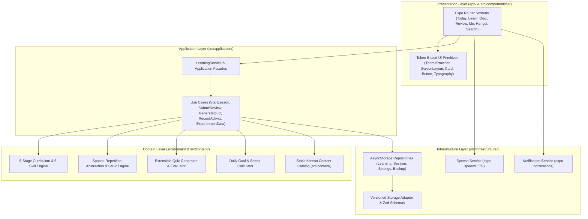

# Klearn — System Architecture

Klearn is a **local-first Korean language learning application** built with **Expo (SDK 57)**, **React Native (0.86)**, **Expo Router**, and **TypeScript**. It is architected around **Clean / Hexagonal Architecture** principles so that core learning algorithms, curriculum structure, and domain rules remain 100% independent of UI frameworks and storage engines.

---

## 1. High-Level Architecture Diagram

---

## 2. Strict Layer Boundaries

| Layer | Directory | Responsibilities | Forbidden Dependencies |
| :--- | :--- | :--- | :--- |
| **Presentation (UI)** | `app/`, `src/components/ui/` | Expo Router screens, modals, navigation, safe-area layout, theme consumption (`useTheme()`). | Must **never** import `@react-native-async-storage/async-storage` directly or embed SM-2/quiz-generation math. |
| **Application** | `src/application/` | Orchestrates domain logic and infrastructure repositories via focused Use Cases (`useCases/`) and `LearningService`. | Must **never** import React components or stylesheet code. |
| **Domain** | `src/domain/` | Pure TypeScript business rules: SM-2 scheduling (`srs/`), quiz generation (`quiz/`), streak math (`streak/`), 5-stage & 6-skill models (`curriculum/`). | Must be **100% pure TypeScript** — zero React, React Native, Expo, or AsyncStorage imports. |
| **Content Catalog** | `src/content/` | Immutable Korean curriculum hierarchy (Levels → Units → Lessons → LearningItems) and Hangul/Number charts. | Must **never** store mutable user progress or review state. |
| **Infrastructure** | `src/infrastructure/` | Concrete implementations of repository interfaces (`storage/`), versioned persistence, TTS (`audio/`), and local reminders (`notifications/`). | Must **never** import UI components. |

---

## 3. Core Domain Invariants

### 3.1 Content vs. User Learning State Separation
Static curriculum content (`LearningItem` in `src/content/`) is strictly separated from mutable user progress (`LearningRecord` and `ReviewState` persisted via `LearningRepository`).
- A vocabulary word or grammar point exists once in the immutable content catalog.
- User mastery, review history, ease factor, interval, and next due date live in `LearningRecord`.

### 3.2 5-Stage Proficiency Journey & 6-Skill Engine
- **5 Stages**:
  1. *Stage 1: Foundations* (Hangul, Batchim, Numbers, Survival Phrases)
  2. *Stage 2: Core Sentence Building* (Particles, Present/Past Tense, Daily Verbs)
  3. *Stage 3: Everyday Communication* (Connectors, Honorifics, Practical Dialogues)
  4. *Stage 4: Intermediate Expression* (Nuance, Idiomatic Patterns, Extended Reading)
  5. *Stage 5: Natural Fluency* (Complex Clauses, Cultural Context, Real-World Mastery)
- **6 Skills**: `reading`, `listening`, `vocabulary`, `grammar`, `sentenceBuilding`, `culturalContext`.

### 3.3 Pluggable Spaced Repetition (SRS)
The SRS engine implements a clean domain contract (`src/domain/srs/`):
- Current implementation: **SM-2** (`sm2.ts`) supporting `Again`, `Hard`, `Good`, and `Easy` ratings.
- Because scheduling is isolated behind the SRS domain module, upgrading or adding alternative algorithms (e.g., FSRS) requires zero changes to UI screens or storage repositories.

### 3.4 Versioned Local-First Storage & Data Portability
- All persisted entities are wrapped in a versioned `StorageEnvelope<T>` validated with `zod` schemas.
- Users can export their entire learning state to JSON, import backups, or reset local storage from the **Me** screen without requiring a backend or user account.

---

## 4. Extension Guide

- **Adding Curriculum Content**: Add items and lessons in `src/content/`, wire them into the stage/unit catalog, and run `npm test -- src/content/catalog.test.ts`.
- **Adding a Quiz Question Format**: Extend `QuizQuestionType` in `src/domain/quiz/`, add generation logic in `generator.ts`, add unit tests in `generator.test.ts`, and render the prompt in `app/quiz/session.tsx`.
- **Adding a Storage Migration**: Increment the schema version in `src/infrastructure/storage/` and provide a migration transformer with a corresponding repository test in `repositories.test.ts`.
